# 3D Equivariant Diffusion for Target-Aware Molecule Generation and Affinity Prediction

[](https://github.com/guanjq/targetdiff/blob/main/LICIENCE)

## This fork: thesis extension (Diagnosing Guidance Failure in Structure-Based Molecular Diffusion)

This repository is a fork of the [official TargetDiff implementation](https://github.com/guanjq/targetdiff)
(all credit for the base model, training pipeline, and original codebase
below belongs to the original authors — see [Citation](#citation)). It
adds a Master's thesis research project built on top of TargetDiff's
frozen, pretrained diffusion model:

> **Diagnosing Guidance Failure in Structure-Based Molecular Diffusion:
> A Leakage-Safe Evaluation with a Positive Control**

Full thesis document: `guidance/thesis/Thesis_Coupled_Guidance_SBDD.pdf`
(278 pages, 10 chapters + 6 appendices A–F, 65 references, 53 tables, 46
figures, built via `guidance/thesis/build_thesis.py`). Every one of its 96
quoted numeric claims is pinned to a source data file and re-checked on
every build (`guidance/thesis/check_numbers_against_sources.py`, 96/96
passing); an independent reproducibility harness
(`guidance/verify_results_reproduce.py`) regenerates 7 seeded analyses
from scratch and diffs them against the committed results field by
field — 1,038/1,038 values match exactly.

**Status: research complete.** Five independent guidance routes
(Chapters IV–VIII), a pre-registered positive control (Chapter VI.5), an
eight-block information-content audit (Chapter IV), and a three-phase,
eight-checkpoint follow-up investigation (Appendix E) are finished,
cross-checked against ground-truth data files, and pooled — 48
independent statistical tests across the follow-up phase alone, 0
significant after Benjamini–Hochberg correction. Every figure below is
reproduced directly from the thesis build. What remains before
submission is administrative only (student/advisor front-matter details,
defense scheduling), not further experiments. A repository-hardening
pass (below) followed the research itself and found and fixed three
real code bugs plus one rendering bug, none of which changed a single
reported number, before this document was last rebuilt.

<p align="center">
  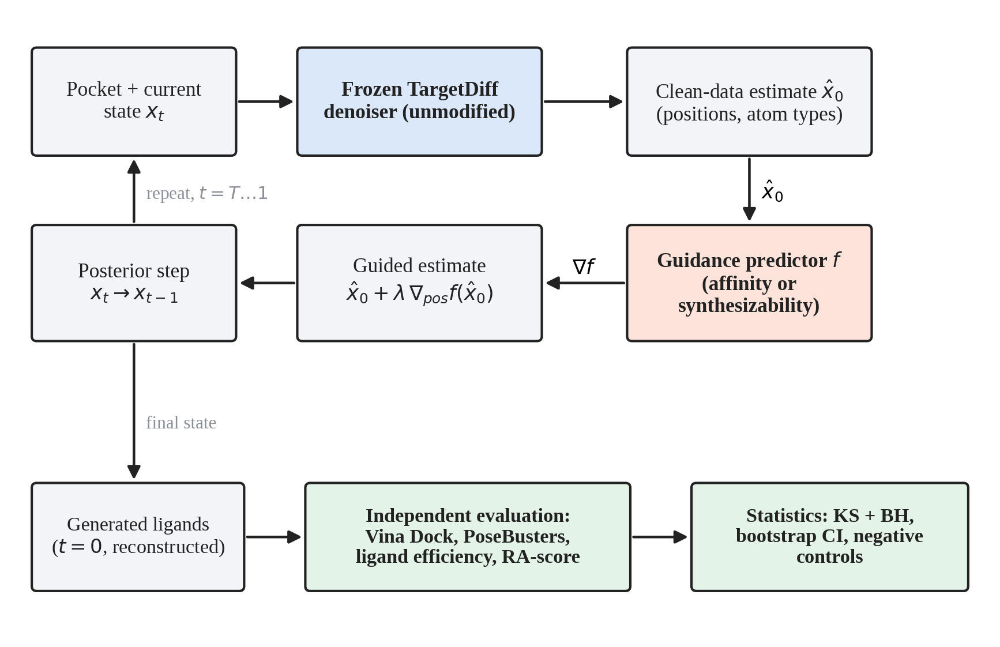<br>
  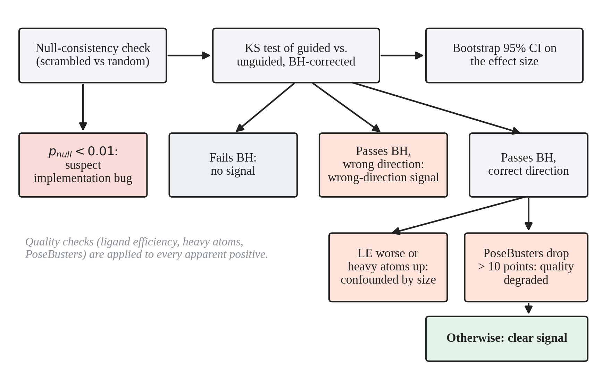
</p>

*Top: the pipeline used by every track below — a frozen TargetDiff
denoiser proposes a clean-data estimate at each reverse step, a guidance
predictor's gradient (w.r.t. atom positions) nudges that estimate, and
the finished molecules are scored by tools fully independent of the
guidance predictor. Bottom: the decision logic applied to every single
comparison — a null-consistency check guards against implementation
bugs, and ligand-efficiency / heavy-atom / PoseBusters checks are applied
to any apparent positive before it is allowed to be called a real
signal.*

<p align="center">
  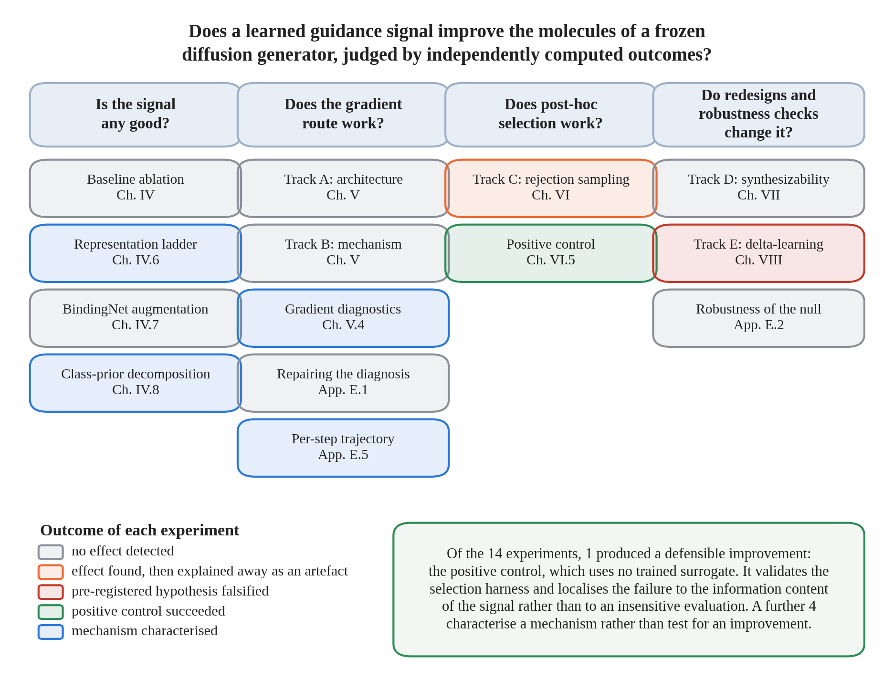
</p>

*A map of the whole thesis: every research objective, the chapter that
answers it, and the outcome it reached, colour-coded so that a falsified
hypothesis, an effect explained away as a size artefact, and a test that
simply detected nothing are kept visually distinct rather than collapsed
into "failed." Generated directly from the objective table in Chapter I,
so the figure and the text it summarises cannot drift apart.*

### What the thesis asked, and found

It is tested whether guiding a frozen TargetDiff model with learned
predictors of binding affinity and synthesizability survives being judged
by independently computed outcomes (AutoDock Vina, PoseBusters, ligand
efficiency, RA-score) rather than by the predictor's own score — and,
where it does not survive, which of three mechanisms explains the
failure: an uninformative signal, a correct signal misapplied by the
guidance mechanism, or an objective that can be gamed without a genuine
improvement. Every comparison uses Kolmogorov–Smirnov tests with
Benjamini–Hochberg correction, bootstrap confidence intervals and
mandatory negative controls — never a bare mean-difference claim.

| Question | Where | Result |
|---|---|---|
| How much of the predictor's apparent quality is real pocket-specific learning? | Ch. IV | 70–90% of apparent R² survives a within-target label permutation that destroys all genuine structure–activity signal; no pocket representation tested, including a chemically typed interaction count, reliably beats a 14-descriptor ligand-only model |
| Does more training data close the gap? (BindingNet augmentation) | Ch. IV | No — a compound-level leak was found and removed first; the augmented arm still did not reach the ligand-only ceiling, and the pure-CrossDocked arm of matched size did descriptively better on less compute |
| Does gradient guidance from a trained affinity predictor move independently scored outcomes? (Track A, physics-anchored GIGN+PIGNet2) | Ch. V | Falsified — no shift across three orders of magnitude of guidance strength, dual-checkpoint verified null |
| Do alternative guidance mechanisms fix it? (Track B: norm normalisation, classifier-head reformulation, timestep-windowing) | Ch. V | Falsified — 3/3 null |
| Does non-gradient rejection sampling (post-hoc top-k ranking by the same trained predictor) do better? (Track C) | Ch. VI | Apparent raw-score gain in 12/15 pockets is a molecule-size artefact — ligand efficiency worsens in 14/15 pockets |
| Can the *selection* harness itself detect a real signal at all? (positive control) | Ch. VI.5 | **Succeeded** — swapping in Vina's own zero-shot score as the ranking signal improves docking score (p = 1.9 × 10⁻⁶) without hurting ligand efficiency (p = 0.756), at the cost of larger, less synthesizable molecules — validates the harness and localises Track C's failure to the predictor's information content |
| Does guidance toward synthesizability work? (Track D) | Ch. VII | Unresolved — own score rises with guidance strength while the independent RA-score moves the other way; the divergence is not statistically confirmed after a leakage-safe retrain |
| Does retraining on a residual against the docking score remove the size shortcut? (Track E, delta-learning) | Ch. VIII | Falsified — R² = 0.117, worse than a two-feature linear baseline (0.362) and an EGNN (0.34–0.41) |

<p align="center">
  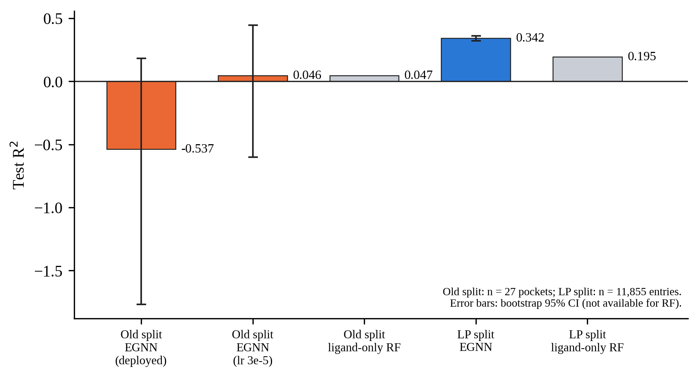
  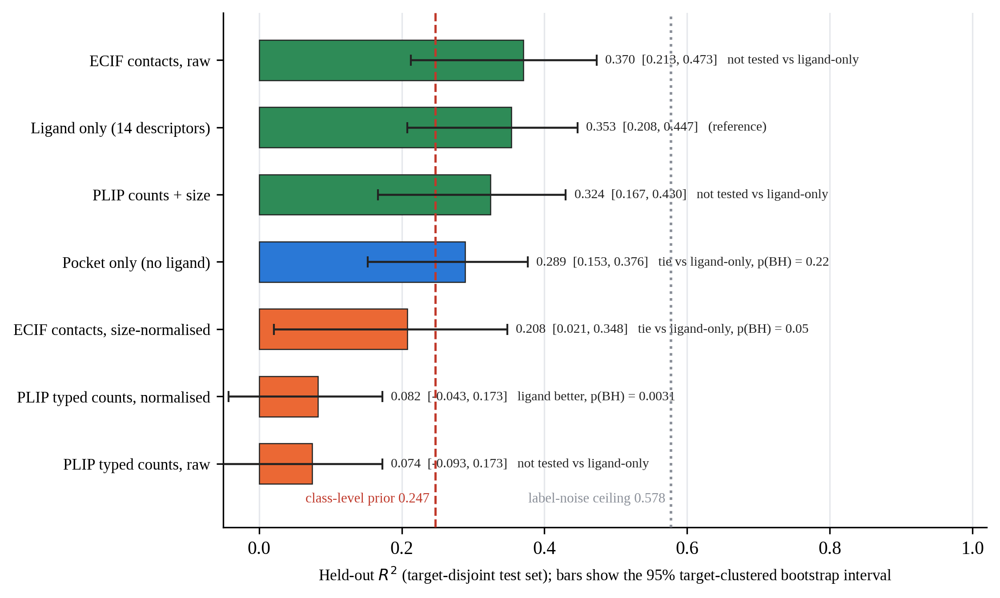
</p>

*Left: on the old, leaky split the affinity predictor looked good; moved
to a target-disjoint, leakage-safe split its R² collapses toward a
ligand-only baseline — the project's first and most consequential
finding. Right: the eight-block information-content audit (Section
IV.8) — a 14-descriptor ligand-only model, a 38-descriptor pocket-only
model, raw and size-normalised interaction-count fingerprints (ECIF,
PLIP), and the EGNN — all overlap, with the one significant difference
against ligand-only running the other way. Vertical lines mark the
class-level prior (0.247) and the estimated label-noise ceiling (0.578).*

<p align="center">
  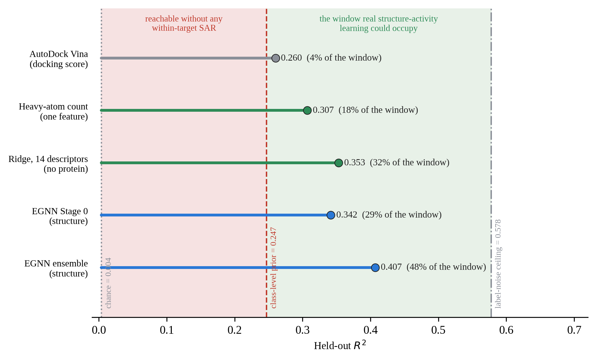
  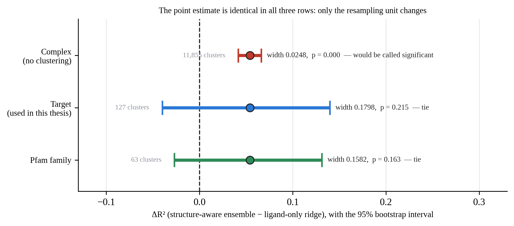
</p>

*Left: moving the zero point from R² = 0 to the class-level prior
(measured by within-target label permutation) shows the window in which
genuine structure–activity learning could sit is narrower than a single
confidence interval on this task; the EGNN occupies 48% of it, a
ligand-only ridge 32%, and the Vina docking score itself only 4%. Right:
the same headline comparison analysed without clustering (significant),
clustered by target (a tie — the result this thesis reports), and
clustered by protein family (unchanged) — the choice of resampling unit,
not the data, decides the chapter's headline verdict.*

<p align="center">
  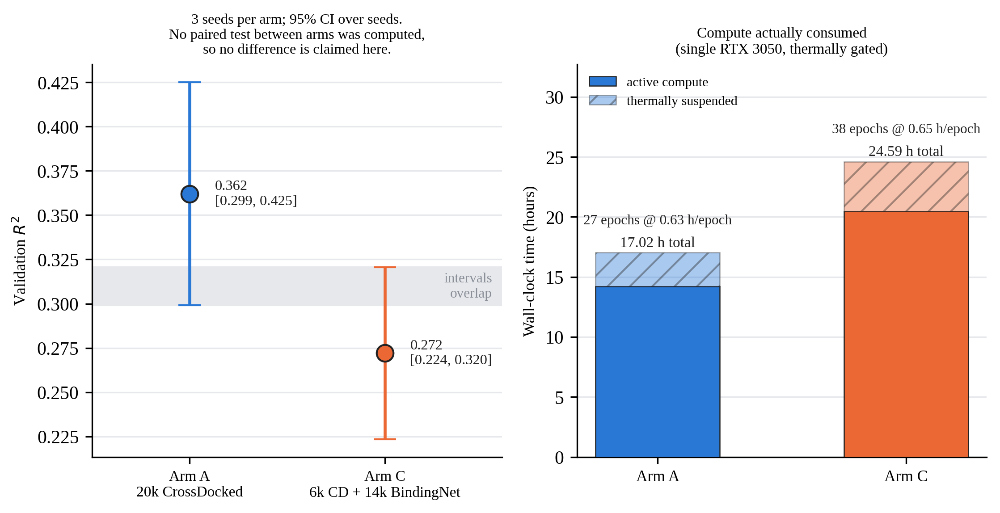
</p>

*Augmenting the training pool with a larger external affinity data set
(BindingNet), after removing a compound-level leak found before the
production run (0.34% of training rows, but 10.1% of evaluation
records), did not close the gap to the ligand-only ceiling at matched
training-set size — and the pure-CrossDocked arm did descriptively
better on 17.0 compute-hours against 24.6.*

<p align="center">
  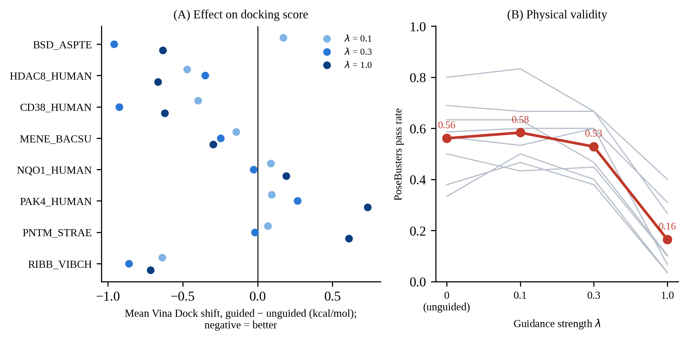
  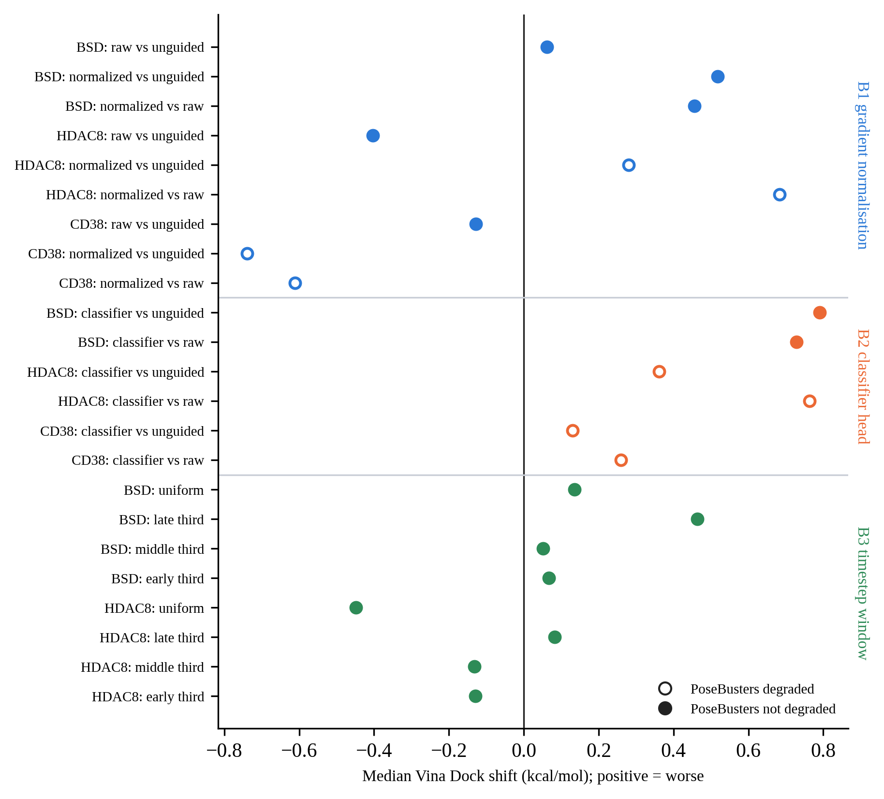
</p>

*Track A (left) and Track B (right): across every pocket, guidance
strength and mechanism variant tried, no shift in the independently
computed Vina Dock score survives multiple-comparison correction.*

<p align="center">
  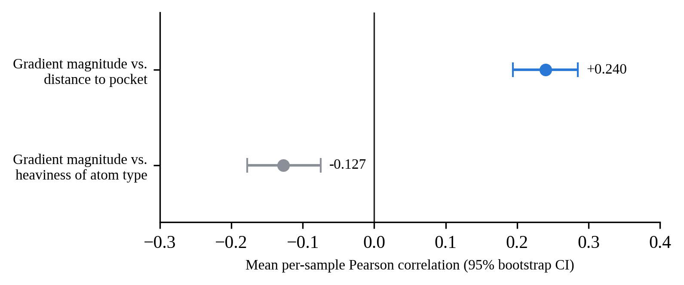
  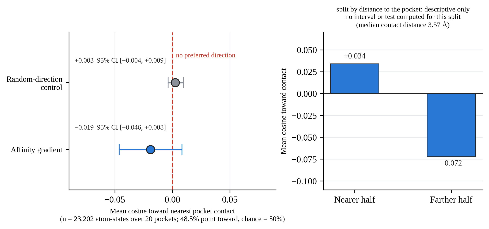
</p>

*Left: the root-cause diagnostic — the affinity predictor's per-atom
gradient magnitude correlates **positively** with an atom's distance
from the pocket (+0.240), the opposite of a chemically meaningful
gradient. Right: a signed measurement over 23,202 captured atom-states
finds the gradient's direction toward the nearest pocket contact
indistinguishable from a random-direction control (mean cosine −0.019,
95% CI [−0.046, +0.008], against +0.003 for the control) — the signal is
uninformative about the interface, not pointed away from it.*

<p align="center">
  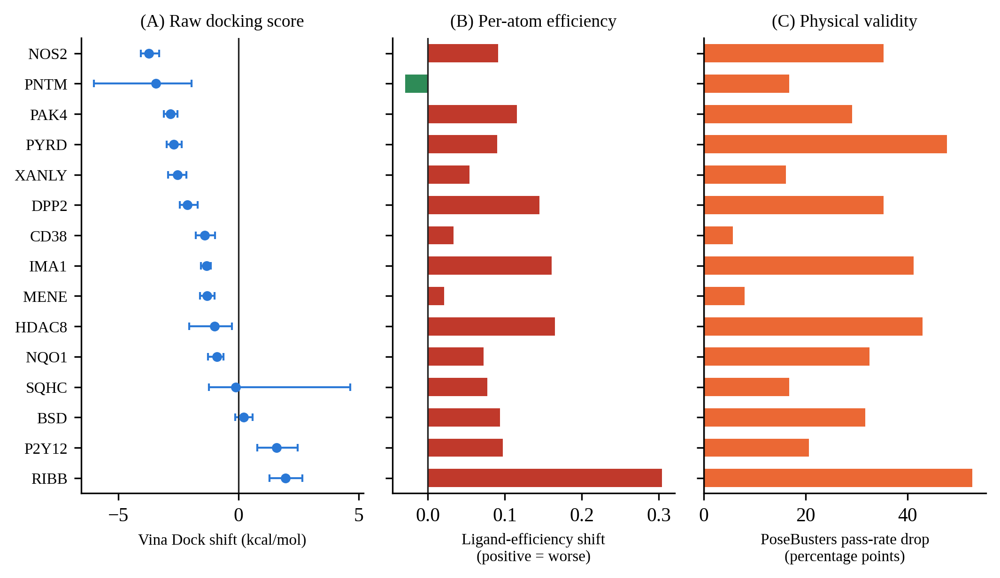
  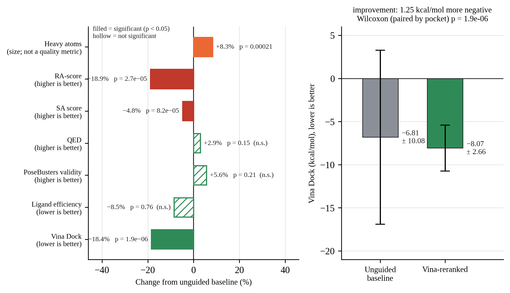
</p>

*Left: Track C's raw Vina Dock improvement in 12/15 pockets disappears
once ligand efficiency and PoseBusters validity are checked — the
trained ranker is simply promoting bigger molecules. Right: the
pre-registered positive control, same mechanism and pockets, but ranking
by Vina's own zero-shot score instead of the trained surrogate —
docking score improves and ligand efficiency holds (unfilled bars are
not significant), at a cost in size and RA-score. Because the selection
score and the evaluation score are two modes of the same docking
program, this validates that the *harness* can detect a real signal; it
localises Track C's failure to the predictor's information content.*

<p align="center">
  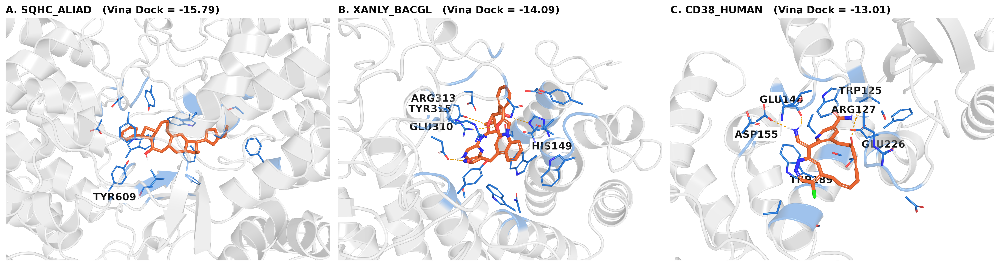
</p>

*Three of the molecules the trained Track C ranker actually promotes,
re-docked and rendered with their hydrogen-bond partners.*

<p align="center">
  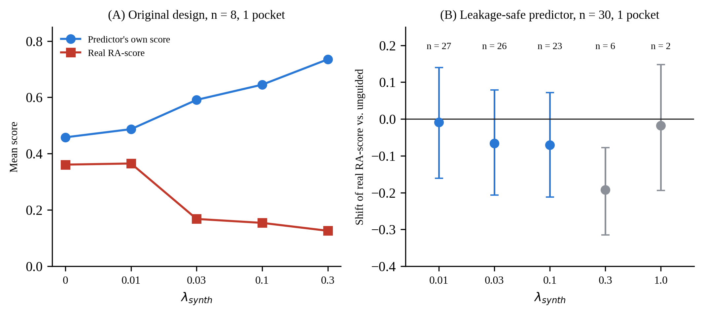
  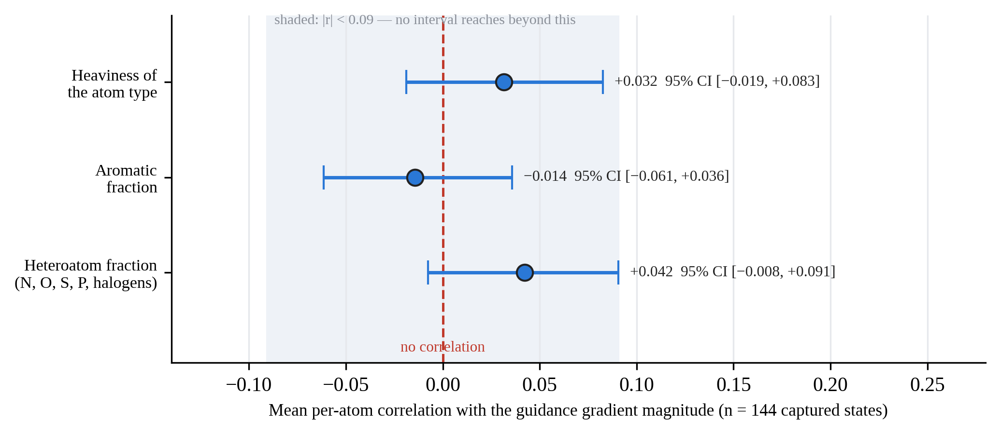
</p>

*Left: the predictor's own score rises with guidance strength while the
independently computed RA-score moves the other way; the divergence
persists in sign after a leakage-safe retrain but is not statistically
confirmed at the powered sample size. Right: unlike the affinity
gradient, the synthesizability gradient shows no detectable correlation
with any of three atom-level proxies — an unresolved mechanism, not a
demonstrated one.*

<p align="center">
  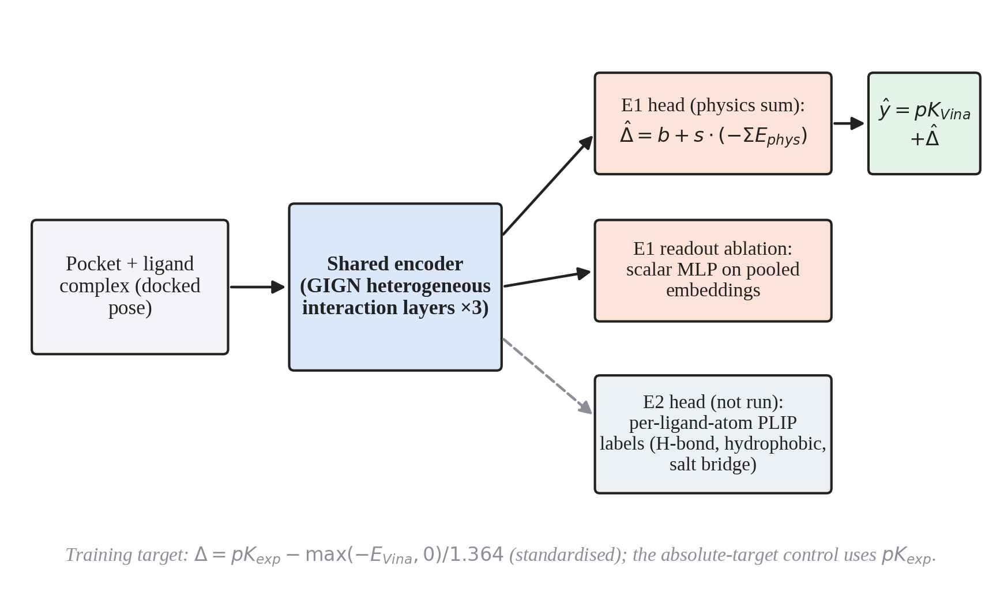
  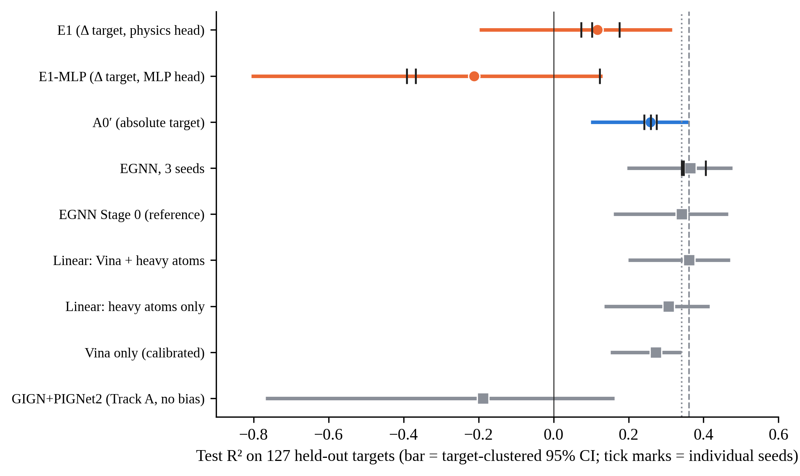
  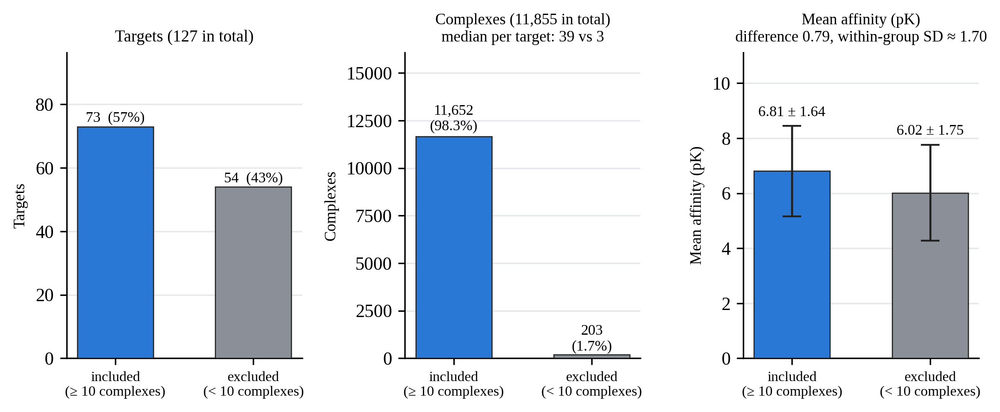
</p>

*Left: instead of the absolute pK, the network predicts the residual
against the Vina docking score, on the premise that this removes the
size shortcut. Centre: it does not help — the residual target is
statistically indistinguishable from, or worse than, a two-feature
linear baseline. Right: the subgroup of 73 of 127 targets large enough
for a within-target ranking metric covers 98.3% of test complexes but
skews 0.79 pK units toward stronger binders — a real but small bias,
disclosed rather than smoothed over.*

<p align="center">
  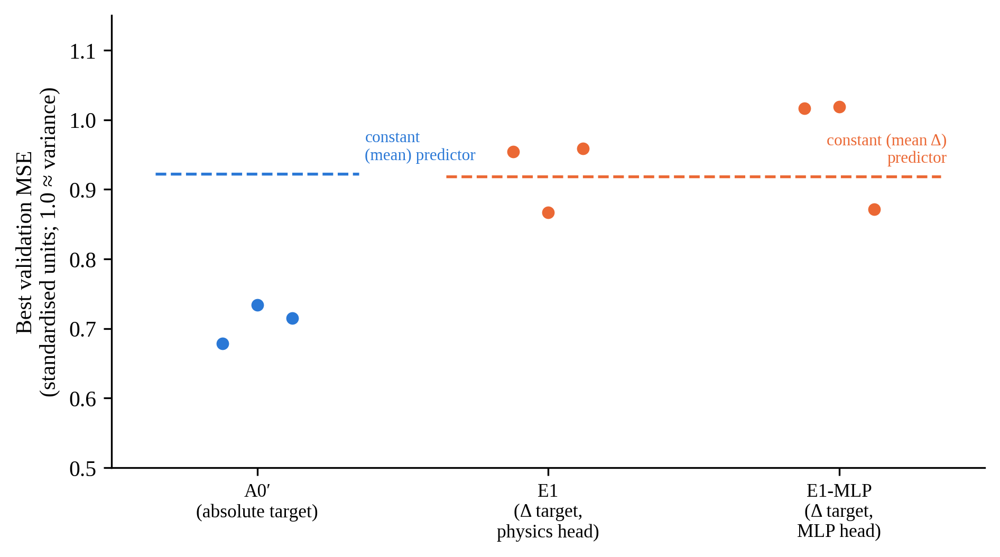
  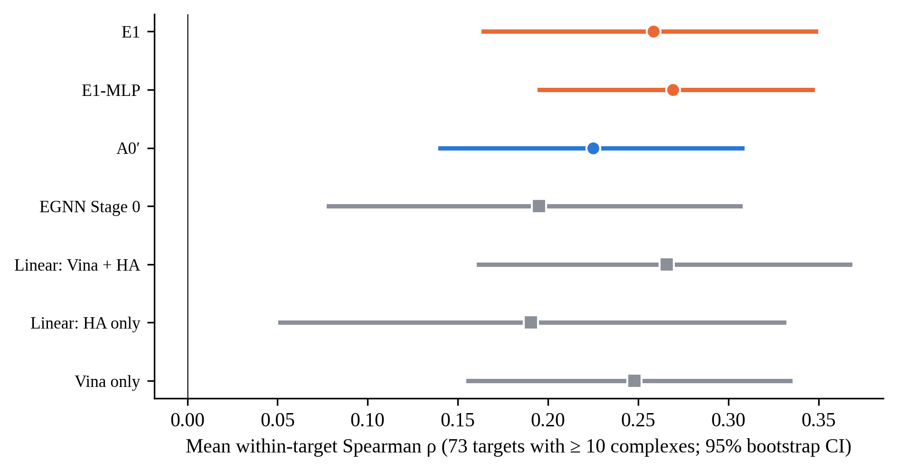
  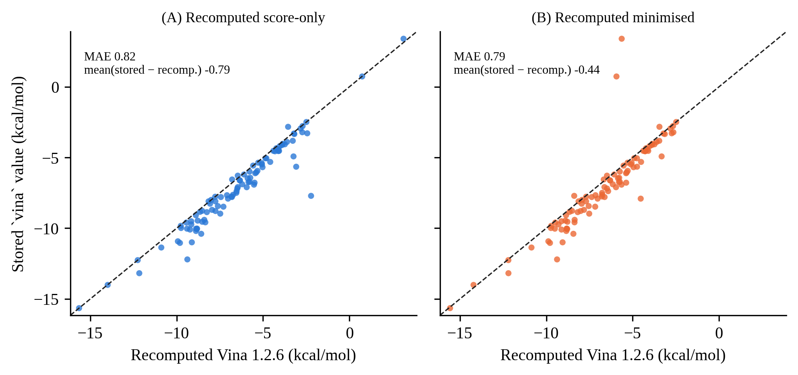
</p>

*Left: the delta target is not learnt better than by a constant
predictor, while the absolute target is — the core negative result of
Track E. Middle: within-target ranking (where guidance actually acts)
doesn't improve either. Right: a sanity check on the Vina anchor score
itself used to build the residual target.*

<p align="center">
  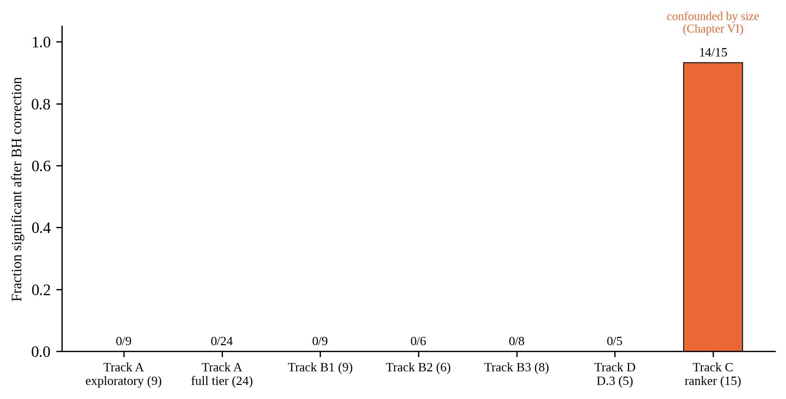
  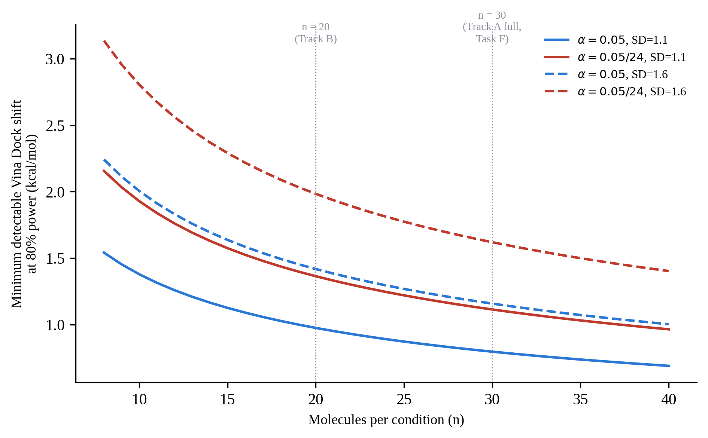
</p>

*Closing the core thesis: the fraction of comparisons that survive
Benjamini-Hochberg correction across every checkpoint (left) — the one
large surviving slice is the positive control, a validated success, not
a route the surrogate-based tracks achieved. Right: the minimum Vina Dock
shift this project's sample sizes could actually detect at 80% power,
showing the nulls above are not simply underpowered.*

All five surrogate-based guidance routes converge on the same root cause
(`guidance/DIAG1_SIZE_CONFOUND_FINDING.md`, Chapter IV.8): the trained
affinity model's apparent accuracy is dominated by a class-level prior
and molecular size, not target-specific binding chemistry, and a model
that does not depend on pose cannot supply a pose-specific gradient. The
positive control of Chapter VI.5 shows this is a property of the
*signal*, not of the evaluation harness.

<p align="center">
  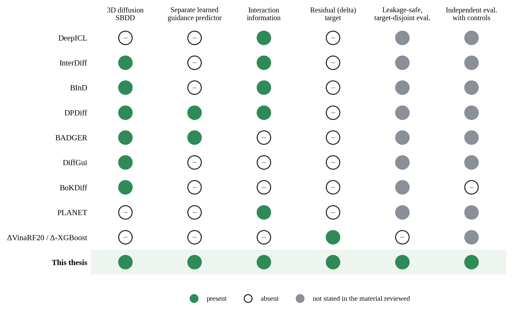
</p>

*Where this thesis sits relative to the closest prior work (Chapter II):
most of the six ingredients compared are individually established
elsewhere, and the gap this thesis occupies is the combination — a
separately learned guidance predictor paired with a leakage-safe,
target-disjoint evaluation under explicit controls, including a
signal-swapped positive control — rather than any single column.*

### Repository hardening: an adversarial audit of the codebase and the build pipeline

After the research itself was finished, the codebase and the thesis
build pipeline went through a full audit — partly self-directed, partly
in response to an external reviewer who read the built PDF directly
rather than taking the source on trust. Three real code bugs were found
and fixed, none of which had affected any committed result:

- A statistics helper (`r2_rows`) was duplicated into a second module
  whose own docstring falsely claimed the duplicate had already been
  removed. The import is now real (`guidance/uncertainty_a1/stats_common.py`),
  verified byte-identical against the five downstream scripts that
  depend on it, and guarded by a project-wide sweep test that fails if
  anything silently redefines it again.
- The sign convention of the core gradient-guidance injection line in
  `guidance/guided_sampling.py` — the single piece of arithmetic that
  every reading of the gradient-direction result (above) depends on —
  had no automated test at all. It now has six deterministic, CPU-only,
  mutation-tested unit tests (`guidance/tests/test_guided_sampling_sign.py`)
  that drive the real, unmodified sampling function through a fully
  known, hand-computable mock.
- A dead branch in the shared coordinate-centering utility
  (`models/molopt_score_model.py`'s `center_pos(mode='none')`) crashed
  if ever called; verified unreachable by any config or call site in the
  project, fixed anyway, and pinned by a regression test.

A fourth issue — a duplicated subsection silently appended to the end of
Appendix E in the rendered PDF — was initially (and wrongly) dismissed
after checking only the source files; checking the rendered PDF directly
with `pdftotext` confirmed it. The root cause was an orphaned
generator-intermediate file picked up a second time by an unrestricted
`glob()`. The fix was paired with defense-in-depth hardening of
`guidance/thesis/build_thesis.py` so the same class of bug cannot
recur silently: an explicit, directory-verified chapter manifest in
place of the blind glob; a `replace_exactly_once()` helper that raises
rather than silently no-op'ing a text fix; two independent duplicate-
heading guards (one at the source level, one reading the rendered PDF
directly); and a content-fingerprint warning for duplicated body text
across chapters. The thesis build's own automated test suite grew from
34 to 56 tests over this pass, and the project-wide test runner
(`guidance/run_tests.py`) currently reports **18 suites, 0 failed, 0
skipped**.

<p align="center">
  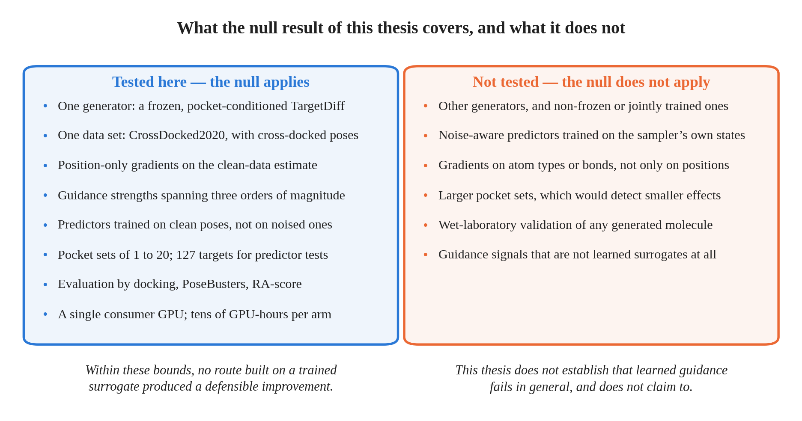
</p>

*The boundary of the null result, drawn directly from the thesis's own
scope and limitations sections: what was actually tested (left), and
what was not, and to which the result therefore does not extend (right).
Included because a null result is the kind of finding most often quoted
beyond its own evidence — "learned guidance did not work here, under
these conditions" is the conclusion; "learned guidance does not work" is
not.*

### Follow-up investigation: does fixing the diagnosed mechanism help? (8 checkpoints, three phases, still no)

<p align="center">
  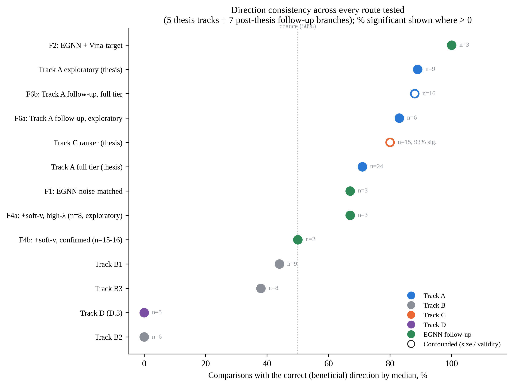
</p>

*The one-figure summary of everything below: direction consistency
(fraction of comparisons favouring guidance) for all five core-thesis
tracks and all seven post-thesis follow-up branches. The single open
marker is Track C, independently shown to be a size artifact — not a
route this appendix falls short of.*

A second phase, reported in full as Appendix E of the thesis, tested
whether directly repairing the diagnosed mechanism — rather than working
around it — produces a real guidance effect, then pushed the question
harder with independent validation, the strictest generalization split
available, and a direct trace of the guidance mechanism itself.

**Phase 1 — repair the predictor (6 checkpoints).** Four interventions
tried alone, in combination (Track A follow-up), and all stacked together
(kitchen-sink), on top of the original Stage 0 EGNN and Track A's
GIGN+PIGNet2 backbones:

| Checkpoint | Best fix | Real-docking effect |
|---|---|---|
| Noise-matched EGNN | Diffusion-matched noise curriculum | Null |
| Vina-target EGNN | Vina-derived pK label instead of experimental | Null |
| Gradient-alignment EGNN | Directly minimizes the diagnosed gradient/distance correlation (-0.78, strongest fix of any checkpoint) | Null — flattest result of all, no encouraging direction at any λ |
| ESM2-augmented EGNN | Adds a protein language-model (ESM2) global feature; best predictive quality (R²=0.460) and best correctly-signed diagnostic (-0.072, significant) of any checkpoint | Closest near-miss — raw p=0.04 at λ=3, but BH-adjusted p≈0.08 and a new validity cost appears at n=24 |
| Track A follow-up (GIGN+PIGNet2 + 2 fixes) | Noise-matching + Vina-target combined | Null — 87.5% direction-consistency (best of this architecture) still 0/16 significant |
| **Kitchen-sink** (all 4 combined) | Every intervention above, stacked | Null — closes the ablation space; no emergent synergy, worst size-confound of any checkpoint |

<p align="center">
  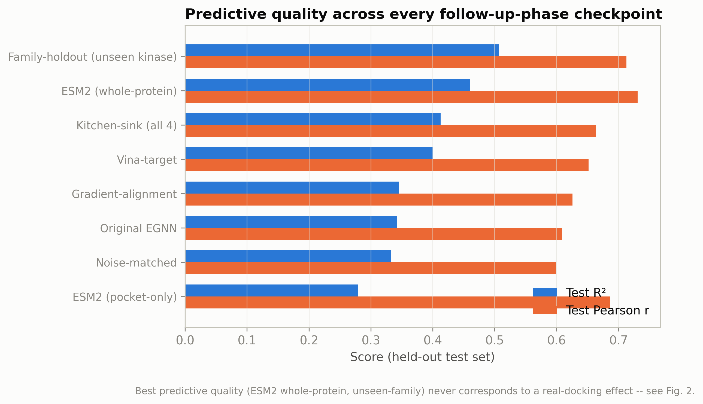
  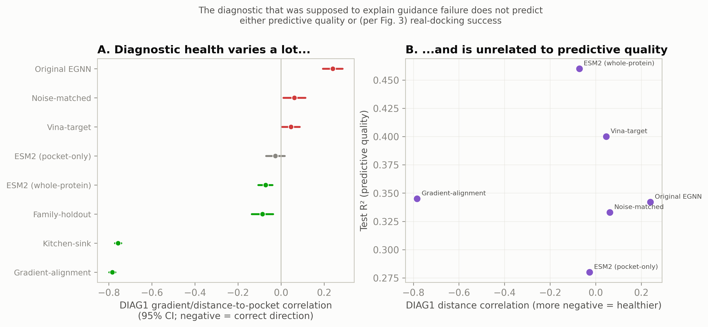
</p>

*Left: predictive quality (R², Pearson, Spearman) of every checkpoint in
the follow-up investigation. Right: the diagnostic fix and the
independently computed docking outcome dissociate across the full range
tested — the checkpoint with the single best diagnostic fix
(gradient-alignment) has the flattest docking result of all.*

<p align="center">
  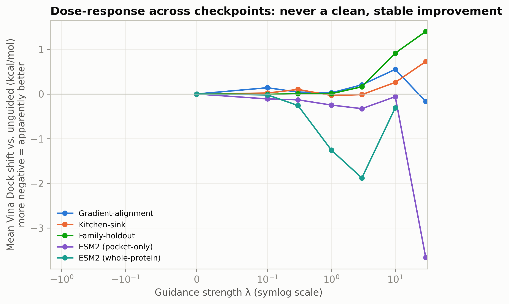
</p>

*The ESM2 checkpoint's closest near-miss, re-examined: going from the
exploratory n=8 (dashed) to the confirmatory n=24 (solid) the effect
size shrinks and a validity cost (lost single-fragment rate) appears
that was invisible at the smaller sample — the same small-n optimism
pattern seen elsewhere in this thesis.*

**Phase 2 — independent validation and the hardest generalization test (1
new checkpoint + 2 analyses on existing checkpoints).** `guidance/PLIP_INTERACTION_VALIDATION_FINDING.md`
asks a sharper question than "did the Vina score improve": does guidance
increase the number of *real, named* interactions (H-bonds, hydrophobic
contacts, pi-stacking, salt bridges, via PLIP) a docked pose actually
forms? An n=8 exploratory signal (interactions down −3.71, Vina Dock up
−2.27 kcal/mol) reversed sign on confirmation at n=16 (interactions
+1.00) — not weakened, reversed. `guidance/FAMILY_HOLDOUT_GENERALIZATION_FINDING.md`
retrains with an entire protein family (PF00069, kinases) held out of
training and tests on CDK6, a major real-world kinase target the model
never saw any relative of: predictive quality holds (R²=0.507) and the
diagnostic is correctly signed and significant (−0.086) for the first
time on a non-forced checkpoint, but the real-docking effect is still
null. `guidance/ALPHAFOLD_POCKET_ROBUSTNESS_FINDING.md` (side analysis)
checks whether AlphaFold DB models could substitute for crystal pockets
across 835 LP-split targets: median pocket RMSD 0.47 Å, pLDDT-RMSD
correlation r=−0.63 (p≈1e-92), but 13/835 (1.6%) targets are "confidently
wrong" (pLDDT>80 yet RMSD>5 Å) — a failure mode pLDDT alone cannot flag.

<p align="center">
  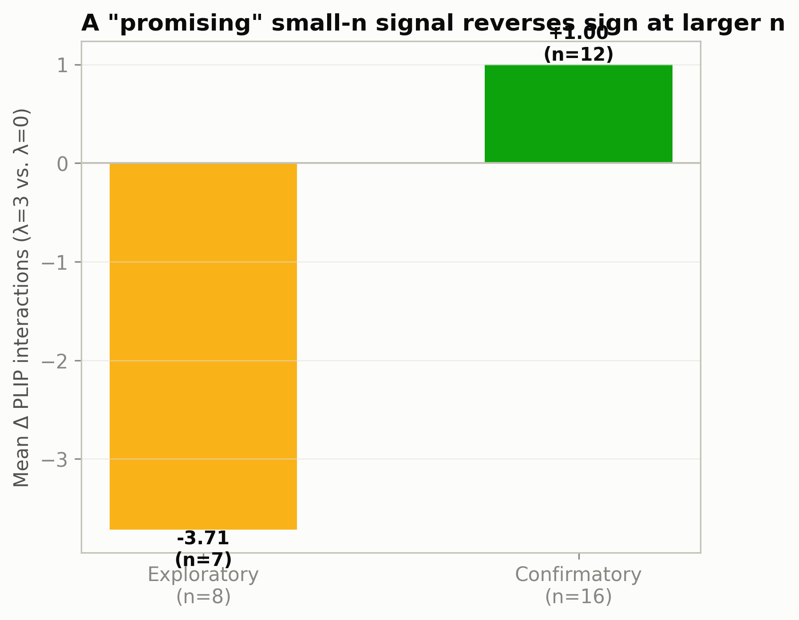
  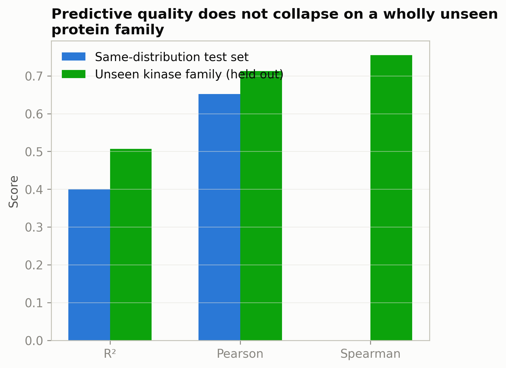
</p>

*Left: the PLIP interaction-count signal at n=8 (exploratory) against
n=16 (confirmatory, new seed) — the sign reverses, not just weakens.
Right: holding out an entire protein family (kinases) and testing on
CDK6 — predictive quality does not collapse, so the null above is not
an artifact of family-level data leakage.*

<p align="center">
  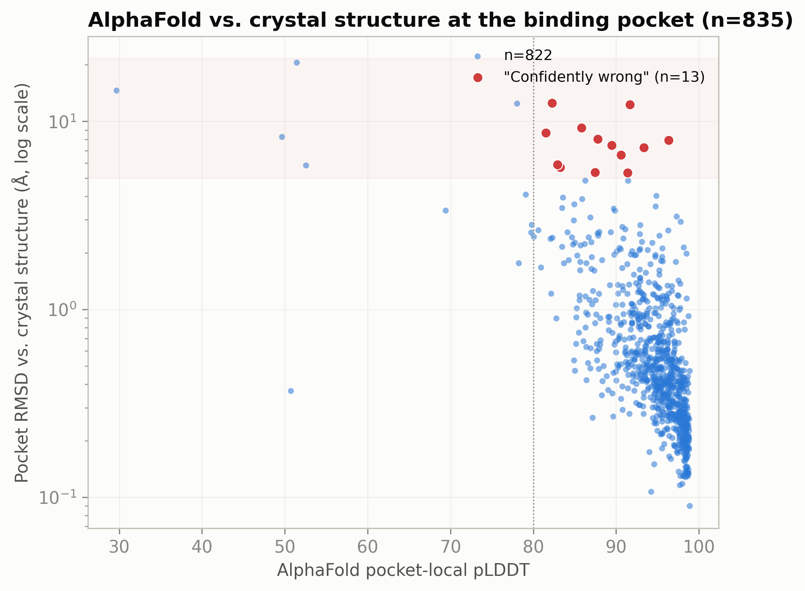
  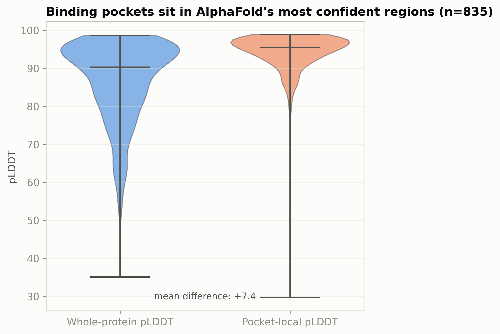
</p>

*Side analysis on whether AlphaFold models could substitute for crystal
pockets: RMSD falls as pLDDT rises (left), but a confidently-wrong
minority remains (lower right) that pLDDT alone cannot flag. Right:
pocket-local confidence exceeds whole-protein confidence by 7.4 points
on average, consistent with binding pockets lying in well-ordered
regions — but that gap does not eliminate the overconfident minority.*

**Phase 3 — sharpen the signal and check the labels (1 new checkpoint + 1
label-verification analysis, later expanded to 17 targets).** `guidance/ESM2POCKET_GUIDANCE_FINDING.md` restricts the ESM2 feature to
only the binding-pocket residues instead of the whole protein: predictive
quality gets *worse* (R²=0.280, down from 0.460), the first checkpoint in
this investigation to actively regress by trying to sharpen a signal.
`guidance/CHEMBL_CROSSVALIDATION_FINDING.md` independently cross-checks
this project's affinity labels against ChEMBL, originally for 4 recurring
targets (3 of 4 agree; CD38 disagrees completely — this project: pK
3.6–4.3, ChEMBL: pChEMBL 7.9–9.5), then expanded to all 13 targets of the
thesis with ChEMBL Ki data: 12 of 13 ranges overlap, and the one
exception (RNAS2) disagrees in the same direction and by nearly the same
margin as CD38 — a genuine, reported discrepancy rather than one
smoothed over or, on wider checking, dismissed as a fluke.

<p align="center">
  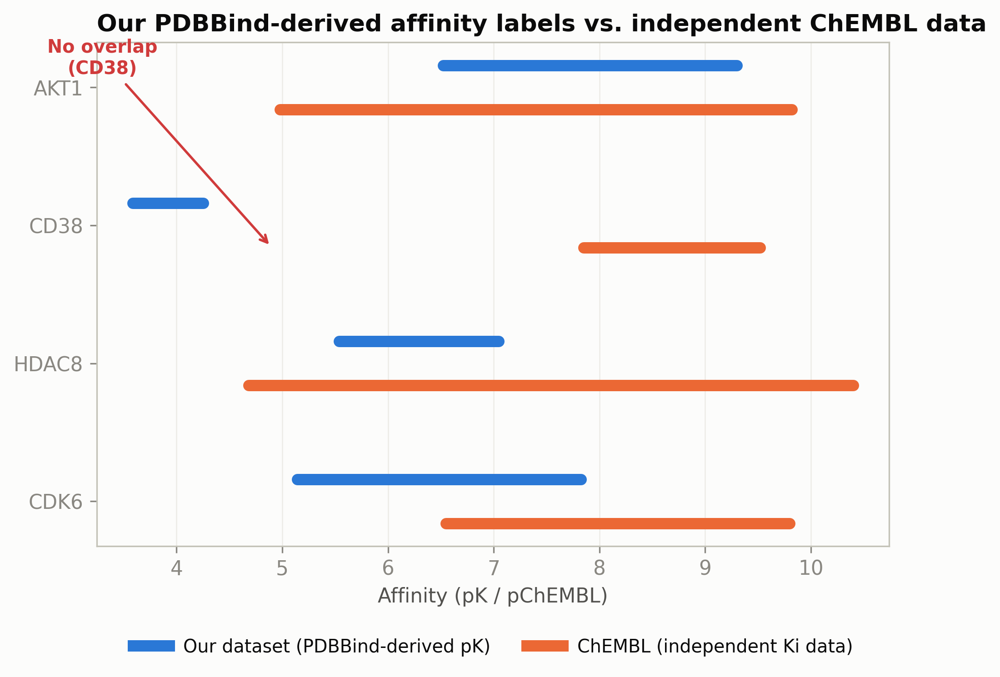
  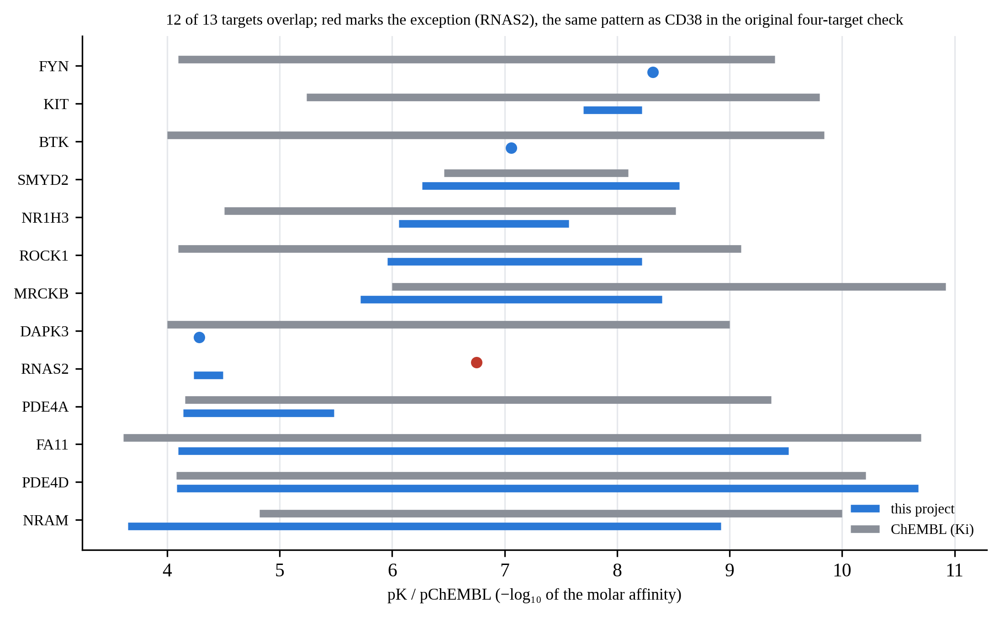
</p>

*Left: the original 4-target independent label cross-check against
ChEMBL. Right: expanded to all 13 targets this project has ChEMBL Ki
data for — 12 of 13 ranges touch; RNAS2 does not, failing to overlap by
nearly two pK units in the same direction as the original CD38
discrepancy.*

**Direct mechanistic trace.** `guidance/GUIDANCE_MECHANISM_TRACE_FINDING.md`
answers the question directly: one molecule, sampled twice from
bit-identical noise (unguided vs. guided), with every reverse-diffusion
step's position gap measured atom by atom. The gap is exactly zero until
guidance starts, grows smoothly, and only accelerates in the final third
of sampling, ending at 0.05 Å mean / 0.13 Å max — about 1% of what the
raw cumulative nudge magnitude (9.49 units) would suggest if nudges
simply added up. Repeating the same trace over 24 molecules (varying only
the seed) shows this 1% figure describes the median case, not every case:
the gap spans a factor of 87 across molecules, and a third of them show
the guidance signal surviving at 4.7–28.5% of the cumulative nudge. The
guidance signal is not being actively cancelled; for most molecules it is
mostly drowned out by the sampler's own intrinsic step noise, a specific
and falsifiable account of why position-only guidance is too weak to
matter in the typical case — though not in every case. (The two
molecules' discrete atom types still end up completely different — a
separate, flagged-as-open "butterfly effect" in the categorical sampling
channel.)

<p align="center">
  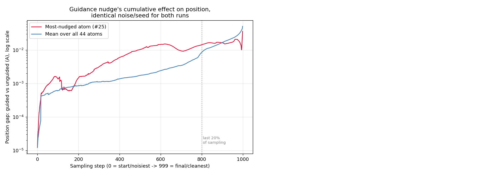
  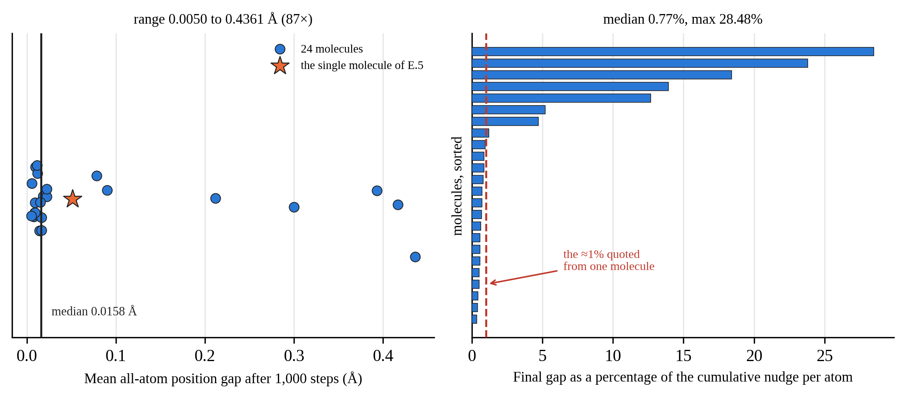
</p>

*Left: the all-atom position gap between the guided and unguided
trajectory for one molecule, step by step. Right: the same measurement
repeated over 24 molecules — the ≈1%-of-nudge figure (dashed line)
describes the median molecule; 8 of 24 exceed it.*

<p align="center">
  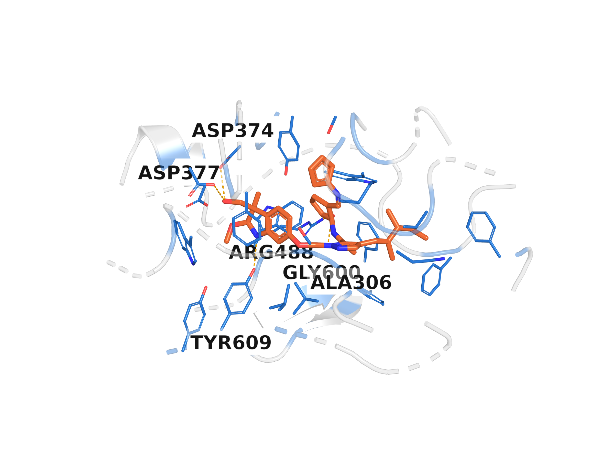
  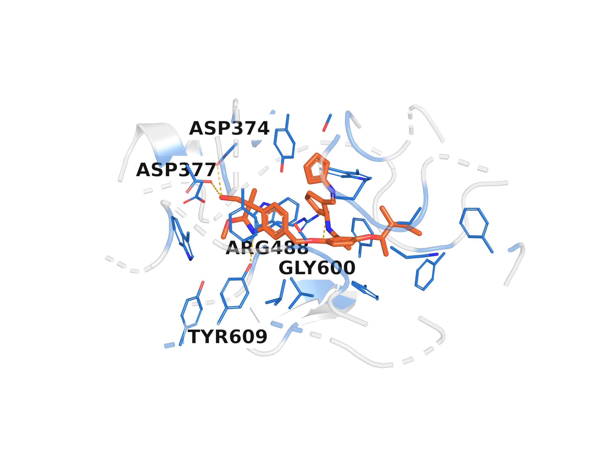
</p>

*The two molecules of the paired trace, rendered in their 3D binding
context (pocket PDB 1h36): unguided (left) and guided from the same
starting noise (right) — the sub-Ångström positional nudge visualised
alongside the discrete identity change it does not, by itself, explain.*

**Pooled result across the entire follow-up phase: 48 independent
statistical tests, 0 significant after Benjamini-Hochberg correction**
(`guidance/FOLLOWUP_PHASE_POOLED_CORRECTION.md`).

<p align="center">
  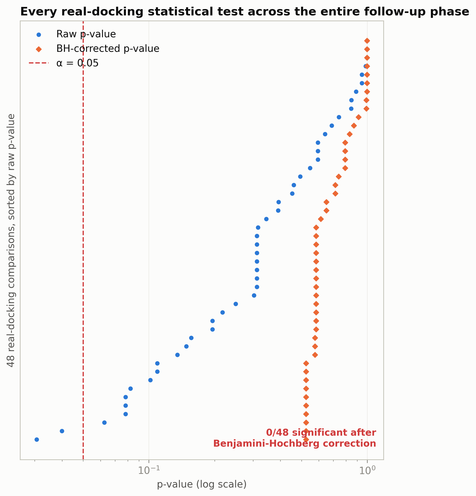
</p>

*Every one of the 48 pooled comparisons, as a forest plot. No interval
is both significant after correction and in the beneficial direction —
the single-figure version of the pooled verdict above.*

The central finding: every mechanism-level fix improves its own
diagnostic or predictive target, independent chemistry-level validation
and the hardest generalization split both agree with the raw-score
result, and the mechanistic trace shows specifically why — the guidance
mechanism itself, not any single diagnosed confound, is the bottleneck
for most molecules.

<p align="center">
  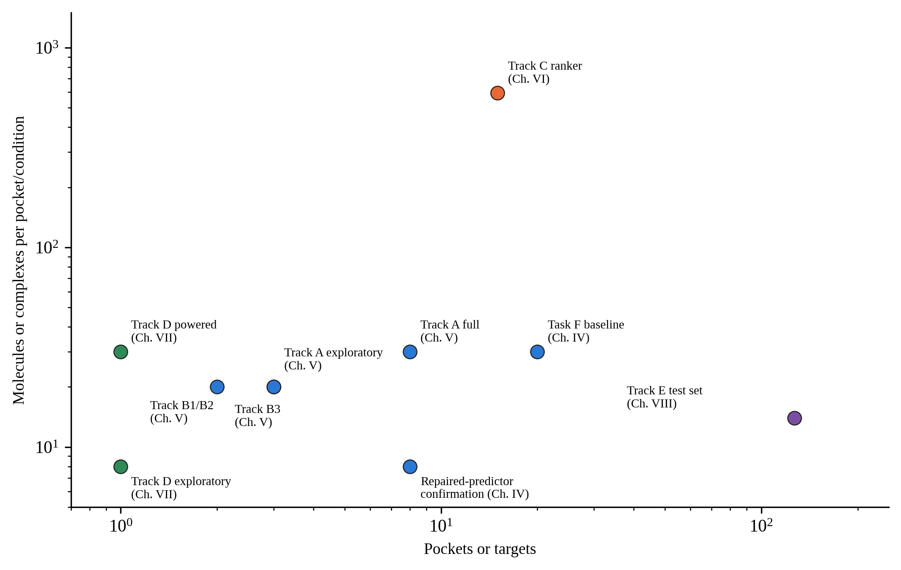
</p>

*For scale: pockets or targets against molecules or complexes evaluated
per condition, for every checkpoint across Chapters IV-VIII — the scope
of evidence behind every null result above.*

**Beyond the submitted thesis.** Chapter X's own proposed extension
(below) requires, as its first and stated prerequisite, that an
uncertainty estimate σ be shown to calibrate against error before any
acquisition rule is built on it. That calibration check has since been
run, beyond the scope claimed by the thesis chapter itself: five
point-wise methods (Monte Carlo dropout, two evidential-regression
variants, heteroscedastic/beta-NLL) were tested and all five failed; only
distribution-free conformal prediction intervals calibrate on this task
(`guidance/RESEARCH_PROGRAM.md`). This is reported here as further,
ongoing repository evidence, not as a result of the thesis document
itself — the extension remains "not tested" exactly as Chapter X states,
and the follow-up now narrows what any future version of it could use.

**Proposed next step (not yet implemented or tested).** Chapter X of the thesis sketches an extension that has not been run, and no result is claimed for it:
- A surrogate with Monte Carlo dropout giving a mean μ and an uncertainty σ. The first check is whether σ correlates with the error on leakage-safe held-out targets — and, per the note above, every point-wise method tried for this has since failed that check.
- Upper-confidence-bound or expected-improvement acquisition applied to the guidance gradient, with a time-dependent weight λ_t (not β_t, which is the DDPM noise schedule).
- PCGrad between the affinity and RA-score gradients, targeting the divergence seen in Track D.
- Evaluation under the same gates as the thesis: BH-corrected KS tests, target-clustered bootstrap, negative controls, and ligand efficiency, heavy-atom count and PoseBusters validity.
- A virtual closed loop with docking scores as feedback is a simulation only. It carries the same size-confound risk as Track C.

Work on DNA-sequence design and laboratory automation is outside this project's scope.

**Start here:**
- `guidance/thesis/chapters/00_abstract.txt` — the full, current thesis abstract, the single most precise statement of every result above
- `guidance/FOLLOWUP_PHASE_POOLED_CORRECTION.md` — the single pooled statistical verdict across the whole follow-up phase
- `guidance/GUIDANCE_MECHANISM_TRACE_FINDING.md` — the direct, step-by-step trace of what guidance does to one molecule
- `guidance/STAGE2_PLUS_EXPERIMENT_LOG.md`, `guidance/RESEARCH_PROGRAM.md` — single sources of truth for every experiment and for the information-problem synthesis across tracks
- `guidance/DUAL_FALSIFICATION_CONCLUSION.md`, `guidance/TRACK_C_REJECTION_SAMPLING_REPORT.md` — core-thesis full write-ups
- `guidance/thesis/chapters/04_predictor_quality.txt` (Chapter IV) — the leakage audit, the eight-block information-content audit, the class-prior decomposition, and the BindingNet augmentation study
- `guidance/thesis/chapters/06_track_c.txt` (Chapter VI, Section VI.5) — the positive-control design and result
- `guidance/thesis/chapters/08_track_e.txt` (Track E, Chapter VIII) — the delta-learning redesign: pre-registration, infrastructure and the falsified result
- `guidance/GRADALIGN_GUIDANCE_FINDING.md`, `guidance/ESM2_GUIDANCE_FINDING.md`, `guidance/ESM2POCKET_GUIDANCE_FINDING.md`, `guidance/KITCHENSINK_GUIDANCE_FINDING.md`, `guidance/TRACK_A_FOLLOWUP_FULL_TIER_FINDING.md` — Phase 1 per-checkpoint write-ups
- `guidance/PLIP_INTERACTION_VALIDATION_FINDING.md`, `guidance/FAMILY_HOLDOUT_GENERALIZATION_FINDING.md`, `guidance/CHEMBL_CROSSVALIDATION_FINDING.md` — Phase 2/3 write-ups
- `guidance/thesis/chapters/11_appendices.txt` (Appendices A–E) and `guidance/thesis/chapters/11z_effect_sizes.txt` (Appendix F) — reproducibility and repository details, the full follow-up assembled into the thesis itself, and the complete effect-size register
- `guidance/thesis/check_numbers_against_sources.py`, `guidance/verify_results_reproduce.py`, `guidance/run_tests.py` — the three automated checks that keep every quoted number, every regenerable analysis, and every test suite honest on each rebuild
- `guidance/generate_molecules_for_target.py` — generate & score candidate molecules for any of the 100 test-set pockets
- `guidance/render_examples.py`, `guidance/build_pptx_glb.py` — publication-quality and PowerPoint-ready 3D visualizations of generated binding poses

This section documents the thesis contribution; everything below is the
original TargetDiff paper/codebase documentation.

-----

This repository is the official implementation of 3D Equivariant Diffusion for Target-Aware Molecule Generation and Affinity Prediction (ICLR 2023). [[PDF]](https://openreview.net/pdf?id=kJqXEPXMsE0) 

<p align="center">
   
</p>

## Installation

### Dependency

The code has been tested in the following environment:


| Package           | Version   |
|-------------------|-----------|
| Python            | 3.8       |
| PyTorch           | 1.13.1    |
| CUDA              | 11.6      |
| PyTorch Geometric | 2.2.0     |
| RDKit             | 2022.03.2 |

### Install via Conda and Pip
```bash
conda create -n targetdiff python=3.8
conda activate targetdiff
conda install pytorch pytorch-cuda=11.6 -c pytorch -c nvidia
conda install pyg -c pyg
conda install rdkit openbabel tensorboard pyyaml easydict python-lmdb -c conda-forge

# For Vina Docking
pip install meeko==0.1.dev3 scipy pdb2pqr vina==1.2.2 
python -m pip install git+https://github.com/Valdes-Tresanco-MS/AutoDockTools_py3
```
The code should work with PyTorch >= 1.9.0 and PyG >= 2.0. You can change the package version according to your need.

### (Alternatively) Install via Mamba
Install Mamba

```bash
wget "https://github.com/conda-forge/miniforge/releases/latest/download/Mambaforge-$(uname)-$(uname -m).sh"
bash Mambaforge-$(uname)-$(uname -m).sh  # accept all terms and install to the default location
rm Mambaforge-$(uname)-$(uname -m).sh  # (optionally) remove installer after using it
source ~/.bashrc  # alternatively, one can restart their shell session to achieve the same result
```

Create Mamba environment
```bash
mamba env create -f environment.yaml
conda activate targetdiff  # note: one still needs to use `conda` to (de)activate environments
```

-----
# Target-Aware Molecule Generation
## Data
The data used for training / evaluating the model are organized in the [data](https://drive.google.com/drive/folders/1j21cc7-97TedKh_El5E34yI8o5ckI7eK?usp=share_link) Google Drive folder.

To train the model from scratch, you need to download the preprocessed lmdb file and split file:
* `crossdocked_v1.1_rmsd1.0_pocket10_processed_final.lmdb`
* `crossdocked_pocket10_pose_split.pt`

To evaluate the model on the test set, you need to download _and_ unzip the `test_set.zip`. It includes the original PDB files that will be used in Vina Docking.

If you want to process the dataset from scratch, you need to download CrossDocked2020 v1.1 from [here](https://bits.csb.pitt.edu/files/crossdock2020/), save it into `data/CrossDocked2020`, and run the scripts in `scripts/data_preparation`:
* [clean_crossdocked.py](scripts/data_preparation/clean_crossdocked.py) will filter the original dataset and keep the ones with RMSD < 1A.
It will generate a `index.pkl` file and create a new directory containing the original filtered data (corresponds to `crossdocked_v1.1_rmsd1.0.tar.gz` in the drive). *You don't need these files if you have downloaded .lmdb file.*
    ```bash
    python scripts/data_preparation/clean_crossdocked.py --source data/CrossDocked2020 --dest data/crossdocked_v1.1_rmsd1.0 --rmsd_thr 1.0
    ```
* [extract_pockets.py](scripts/data_preparation/extract_pockets.py) will clip the original protein file to a 10A region around the binding molecule. E.g.
    ```bash
    python scripts/data_preparation/extract_pockets.py --source data/crossdocked_v1.1_rmsd1.0 --dest data/crossdocked_v1.1_rmsd1.0_pocket10
    ```
* [split_pl_dataset.py](scripts/data_preparation/split_pl_dataset.py) will split the training and test set. We use the same split `split_by_name.pt` as 
[AR](https://arxiv.org/abs/2203.10446) and [Pocket2Mol](https://arxiv.org/abs/2205.07249), which can also be downloaded in the Google Drive - data folder.
    ```bash
    python scripts/data_preparation/split_pl_dataset.py --path data/crossdocked_v1.1_rmsd1.0_pocket10 --dest data/crossdocked_pocket10_pose_split.pt --fixed_split data/split_by_name.pt
    ```
## Training
### Training from scratch
```bash
python scripts/train_diffusion.py configs/training.yml
```
### Trained model checkpoint
https://drive.google.com/drive/folders/1-ftaIrTXjWFhw3-0Twkrs5m0yX6CNarz?usp=share_link

## Sampling
### Sampling for pockets in the testset
```bash
python scripts/sample_diffusion.py configs/sampling.yml --data_id {i} # Replace {i} with the index of the data. i should be between 0 and 99 for the testset.
```
You can also speed up sampling with multiple GPUs, e.g.:
```bash
CUDA_VISIBLE_DEVICES=0 bash scripts/batch_sample_diffusion.sh configs/sampling.yml outputs 4 0 0
CUDA_VISIBLE_DEVICES=1 bash scripts/batch_sample_diffusion.sh configs/sampling.yml outputs 4 1 0
CUDA_VISIBLE_DEVICES=2 bash scripts/batch_sample_diffusion.sh configs/sampling.yml outputs 4 2 0
CUDA_VISIBLE_DEVICES=3 bash scripts/batch_sample_diffusion.sh configs/sampling.yml outputs 4 3 0
```

### Sampling from pdb file
To sample from a protein pocket (a 10A region around the reference ligand):
```bash
python scripts/sample_for_pocket.py configs/sampling.yml --pdb_path examples/1h36_A_rec_1h36_r88_lig_tt_docked_0_pocket10.pdb
```

## Evaluation
### Evaluation from sampling results
```bash
python scripts/evaluate_diffusion.py {OUTPUT_DIR} --docking_mode vina_score --protein_root data/test_set
```
The docking mode can be chosen from {qvina, vina_score, vina_dock, none}

Note: It will take some time to prepare pqdqt and pqr files when you run the evaluation code with vina_score/vina_dock docking mode for the first time.

### Evaluation from meta files
We provide the sampling results (also docked) of our model and CVAE, AR, Pocket2Mol baselines [here](https://drive.google.com/drive/folders/19imu-mlwrjnQhgbXpwsLgA17s1Rv70YS?usp=share_link).

| Metafile Name                   | Original Paper                                                                                      |
|---------------------------------|-------------------------------------------------------------------------------------------------------|
| crossdocked_test_vina_docked.pt | -                                                                                                   |
| cvae_vina_docked.pt             | [liGAN](https://arxiv.org/abs/2110.15200)                                                           |
| ar_vina_docked.pt               | [AR](https://proceedings.neurips.cc/paper/2021/hash/314450613369e0ee72d0da7f6fee773c-Abstract.html) |
| pocket2mol_vina_docked.pt       | [Pocket2Mol](https://proceedings.mlr.press/v162/peng22b.html)                                       |
| targetdiff_vina_docked.pt       | [TargetDiff](https://openreview.net/pdf?id=kJqXEPXMsE0)                                             |

You can directly evaluate from the meta file, e.g.:
```bash
python scripts/evaluate_from_meta.py sampling_results/targetdiff_vina_docked.pt --result_path eval_targetdiff
```

**One can reproduce the results reported in the paper quickly with [notebooks/summary.ipynb](notebooks/summary.ipynb)**

-----
# Binding Affinity Prediction

## Data
* In the unsupervised learning setting, we still use the CrossDocked2020 dataset and find the data with experimentally measured binding affinity (saved in `affinity_info.pkl`) for further analysis. 

* In the supervised learning setting, we use the PDBBind dataset, which can be downloaded from: http://www.pdbbind.org.cn. 
The downloaded refined / general set should be saved in data/pdbbind_v{YEAR} directory. 

Take the PDBBind v2016 for example, you need to first unzip the data:
```bash
mkdir -p data/pdbbind_v2016 && tar -xzvf data/pdbbind_v2016_refined.tar.gz -C data/pdbbind_v2016
```
Then, you can extract 10A pockets and split the dataset using the following commands:
```bash
# extract pockets
python scripts/property_prediction/extract_pockets.py --source data/pdbbind_v2016 --subset refined --refined_index_pkl data/pdbbind_v2016/pocket_10_refined/index.pkl

# split dataset
python scripts/property_prediction/pdbbind_split.py --index_path data/pdbbind_v2016/pocket_10_refined/index.pkl  --save_path data/pdbbind_v2016/pocket_10_refined/split.pt
```

## Training
One can train the binding affinity prediction model with:
```bash
python scripts/property_prediction/train_prop.py configs/prop/pdbbind_general_egnn.yml
```

It is also possible to enhance the model with extra features extracted from the unsupervised generative model. You need to first export the hidden states with:

```bash
python scripts/likelihood_est_diffusion_pdbbind.py
```

This command will dump various meta information and 
you need to specify the feature you want to use in the training config (like `configs/prop/pdbbind_general_egnn.yml`) of the following supervised prediction model.

### Trained model checkpoint
_NOTE: For the supervised learning setting, since the training results on PDBBind v2020 are lost by accident, 
we can only provide the model checkpoint trained on PDBBind v2016 in the preliminary experiments for now. 
However, it can already make accurate prediction for the practical use. 
We will retrain the models on PDBBind v2020 and provide the trained checkpoints as soon._

https://drive.google.com/drive/folders/1-ftaIrTXjWFhw3-0Twkrs5m0yX6CNarz?usp=share_link


## Evaluation
* For the unsupervised learning evaluation, please check [notebooks/analyze_affinity.ipynb](notebooks/analyze_affinity.ipynb)

* For the supervised learning evaluation, one can use the following command to evaluate on the tes set:
```bash
python scripts/property_prediction/eval_prop.py --ckpt_path pretrained_models/egnn_pdbbind_v2016.pt
```
Expected results:

| RMSE  | MAE   | R^2   | Pearson | Spearman |
|-------|-------|-------|---------|----------|
| 1.316 | 1.031 | 0.633 | 0.797   | 0.782    |


## Inference
To predict the binding affinity of a complex, one need to prepare the PDB file and SDF/MOL2 file first
(**Important: for the supervised learning model trained on PDBBind v2016, both protein and ligand need to have hydrogen atoms**). 
Then, the binding affinity can be predicted with [scripts/property_prediction/inference.py](scripts/property_prediction/inference.py). For example,
```bash
python scripts/property_prediction/inference.py \
  --ckpt_path pretrained_models/egnn_pdbbind_v2016.pt \
  --protein_path examples/3ug2_protein.pdb \
  --ligand_path examples/3ug2_ligand.sdf \
  --kind Kd
```

Expected prediction: Kd=5.23 nm.  Ground-truth: Kd=5.6 nm

## Citation
```
@inproceedings{guan3d,
  title={3D Equivariant Diffusion for Target-Aware Molecule Generation and Affinity Prediction},
  author={Guan, Jiaqi and Qian, Wesley Wei and Peng, Xingang and Su, Yufeng and Peng, Jian and Ma, Jianzhu},
  booktitle={International Conference on Learning Representations},
  year={2023}
}
```
